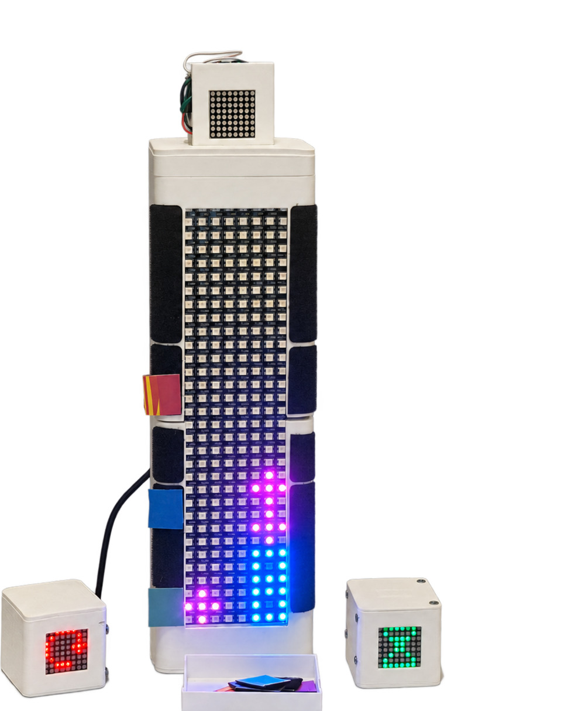

# Time Tokens & Time Tower

A tangible time-awareness system for shared spaces — DECO3500 (Assignment 3: Design Project), Team 3 ("GG").

Three activity Tokens — **Study, Exercise and Gaming** — each turn a chosen hour into a tangible unit. Flip a Token to start the hour; the completed unit transfers to a shared **Time Tower** and becomes a coloured activity trace. The Tower carries two columns, so two people's records sit side by side, and hook-and-loop strips down its side let each person mark what they *planned* beside what actually accumulated.

**Design question:** how might we make personal time use visible and encourage reflection, without judging or restricting people's activities?

We began from a brief about combatting computer game addiction and moved away from it early: our interviews showed the same number of hours means different things in different lives, so restricting play responds to the wrong variable. Time Tokens visualises recorded activity time — not productivity.



---

## Where everything lives

| Deliverable | Location |
|---|---|
| **Prototype** | [`/prototype/`](prototype/README.md) — in this repo, see below |
| **Ongoing documentation** | [`/research/`](research/README.md) · [`/design/`](design/README.md) · [`/process/`](process/README.md) |
| **Poster** | [`/design/poster/`](design/poster/README.md) |
| **Team contributions** | [`/team/`](team/README.md) |
| **Design Process Overview** | [Wiki page](../../wiki/Design-Process-Overview) |
| **Ethical Considerations** | [Wiki page](../../wiki/Ethical-Considerations) |
| **Stand-up records** | [Wiki page](../../wiki/Team-Meetings) · [Week 9 Stand-up](../../wiki/Week-9-Stand-up) |
| **Tasks & issues** | [GitHub Projects](../../projects) — tracked as issues, not as files |

The full [Wiki](../../wiki) also holds User Research, Requirements, Design Iterations, and User Evaluation.

---

## Prototype: Deploy & Usage

The prototype is **physical hardware** — two 3D-printed devices with embedded electronics. There is no web app, no server, and **no login or account of any kind**. "Deployment" means assembling the devices and flashing the controllers.

### What you need

**Time Token** (personal cube, ~60 × 60 × 60 mm)

| Component | Purpose |
|---|---|
| Waveshare ESP32-S3-Zero | Controller, sensor reading, LED control |
| MMA8452Q accelerometer | Detects which face is up → starts a time unit |
| MAX7219 8 × 8 LED module | Timing progress and completion animation |
| 5 V three-pin vibration module | Haptic feedback on completion *(not yet working — see limitations)* |
| Mini breadboard | Prototype wiring |

**Time Tower** (shared display, ~400 mm tall)

| Component | Purpose |
|---|---|
| WS2812B 8 × 32 RGB LED panel | Vertical record of accumulated time |
| Arduino UNO R4 Minima | Drives the Tower display |
| ESP32-S3-Zero | Planned receiver for Token data |
| CUKTECH 15 PB200 power bank | Portable power for the Tower |

Printed parts, CAD/STL files, and assembly photographs: [`/prototype/figures/`](prototype/figures/).

### Running it

1. **Power** — the Token runs on external USB-C (no internal battery in this version). The Tower runs from the PB200 power bank; high LED current must not pass through the UNO R4 Minima.
2. **Flash the Token** — upload the firmware to the ESP32-S3-Zero.
3. **Flash the Tower** — upload the display logic to the UNO R4 Minima.
4. **Use it** — place the Token in the assigned orientation for the activity you're starting. The accelerometer detects the position and begins a time unit; the LED matrix animates progress. *The current firmware uses an eight-second unit for demonstration — the real duration is a design setting, not a fixed value.* On completion, the LED plays a completion animation.
5. **Dock it** — the Token fits the 62 × 62 mm recess in the Tower's top cap.

> <!-- TODO: 以下由负责硬件的队友补齐 -->
> **Still to document here:** exact firmware upload steps (IDE/toolchain and board settings), library dependencies, pin assignments, and where the firmware source lives in this repo. Full hardware build record: [`/prototype/README.md`](prototype/README.md).

### Known limitations

| Function | Status |
|---|---|
| Orientation sensing | Verified separately |
| LED display | Partially verified — power stability still under review |
| Vibration feedback | **Not working** — GPIO switches correctly but the purchased module does not vibrate |
| Token → Tower communication | Intended function — ESP32 space reserved, not yet integrated |
| Tower time record | Structure designed, display logic in testing |
| Token-in-Tower fit | CAD interference check passed; final physical fitting photo pending |

Current development status and next iteration: [`/prototype/development-record.md`](prototype/development-record.md).

---

## Repository map

```text
.
├── research/        01. user research and evaluation
│   ├── literature/        literature and theory
│   ├── interviews/        14 transcripts, 2 with audio
│   ├── analysis/          affinity mapping, themes
│   └── user_test/         round_1/ · round_2/ · evaluation_analysis.md
│
├── design/          02. design process and outputs
│   ├── initial_concepts/  early concepts and sketches
│   ├── design_sprints/    sprint 1 and 2
│   ├── frameworks/        design theory and what it changed
│   ├── iterations/        how the design changed, and why
│   ├── interaction_flow/  how the final system is used
│   ├── poster/            the A2 poster and its copy
│   └── promotional/       demo video, exhibition photos
│
├── prototype/       03. the prototype and its build
│   ├── time_token/        firmware · hardware · cad · photos
│   ├── time_tower/        firmware · hardware · cad · photos
│   ├── communication/     ESP-NOW between the two
│   └── figures/           enclosure iteration figures
│
├── process/         04. project management
│   ├── meeting_notes/     team meetings, and how we meet
│   ├── decisions/         decision records, ethical disclaimer
│   ├── risks_and_limitations.md
│   └── ai_use_declaration.md
│
├── team/            05. contributions and evidence
│   ├── team_contributions.md
│   └── individual_evidence/
│
└── .github/         issue template used by the Projects board
```

## Team

| Member | Focus |
|---|---|
| Yucheng Chen | Ethical considerations · wiki structure & documentation |
| Yiyang Qin | Hardware prototyping · electronics integration · modelling & 3D printing |
| Bo Wang | Prototype development · interaction implementation · user evaluation |
| Zhaoguo Huang | User research · evaluation planning · insight synthesis |
| Yuming Zhong | User research · interviews |

## Links

- [Wiki](../../wiki) — design process overview, ethical considerations, stand-up records
- [GitHub Projects](../../projects) — task and issue tracking
- [Miro board](https://miro.com/app/board/uXjVHzNW9XU=/) — design sprint and research workspace
