# Time Token and Time Tower

*Product Operation · Component Selection · Physical Iterations · Firmware Development and Evaluation*

This document begins with the product system and brings together two related development records: the original **physical design and making process** (Sections 6–10) and the subsequent **firmware implementation and testing process** (Section 11). It explains how the Time Tokens and Time Tower were built, how the code was implemented in stages, which issues led to revisions, and what remains unverified. Earlier domain research and broad concept exploration are outside its scope.

| Record | Contributor | Record date |
| --- | --- | --- |
| Physical design, enclosure, CAD, printing and fitting (Sections 6–10) | Yiyang Qin | 18 September 2026 original record |
| Firmware development, communication integration, debugging and later prototype tests (Section 11) | Bo Wang | Updated 25 October 2026 |

> **Contribution and evidence note:** The physical record and the firmware record describe different workstreams. The first-person contribution statement in Section 10.1 belongs to the physical-design record; the first-person firmware account in Section 11.13 belongs to the firmware workstream. Historical tests and later integrated firmware are distinguished instead of treating all functions as having been finished by 18 September.

| Document scope | Included content |
| --- | --- |
| Product | Time Token and Time Tower |
| Development evidence | Quotation, component selection, CAD/STL, physical fitting, full Arduino sketches, UART/ESP-NOW logs, test feedback and iteration decisions |
| Iteration count | Four *physical* iterations are kept as originally documented; firmware iterations are separately described by technical milestones in Section 11 |
| Evidence boundary | Distinguishes original September snapshots, confirmed physical observations, current source-code capabilities and hardware issues requiring further testing |

## 6  How Time Token and Time Tower Work

Time Token is a personal timing device measuring about 60 × 60 × 60 mm. Time Tower is a shared display about 400 mm tall. Together, they turn an abstract time plan into physical feedback that users can pick up, turn over, view, and accumulate. The Token manages the start, progress, and completion of one time unit. The Tower organises completed units into a vertical record of the day.


Figure 1. Three Time Token lid versions for study, entertainment, and rest.

### 6.1  Time Token Interaction: Design Intention and Later Firmware

- The user selects the physical Token for the activity they intend to record. The original lid designs were labelled study, entertainment and rest; the integrated code identifies the three devices as **Study (ID 2), Gaming (ID 3), and Exercise (ID 1)**. These physical labels and firmware categories must be consistent in the exhibition.

- When the Token is deliberately turned from its normal face to the active face, the MMA8452Q accelerometer measures orientation. The firmware uses filtered Z-axis readings and a short stable hold before starting a time unit.

- The 8 × 8 MAX7219 matrix displays a progressive full-panel animation. Each second fills one entire row, from the viewer's bottom to top **when the Token is physically inverted**. The current demonstration runs for **8 seconds to represent one conceptual hour**; real one-hour behaviour has not been validated in long-term use.

- At completion, the Token displays its completion feedback and sends one time unit automatically. The vibration module was allocated an output pin, but **actual haptic feedback remains unverified** and must not be treated as an established feature.

- Automatic submission is implemented through **ESP-NOW → Tower ESP32 → UART → UNO R4**. A successful `DROP_DONE` returned by the R4 is relayed to the Token as a final acknowledgement; the Token alternates an inverted **checkmark and clockwise return arrow** to prompt the next flip. Earlier physical testing confirmed one complete `DROP_DONE` return path; the later DemoCycle v3 system still needs comprehensive five-board endurance testing.

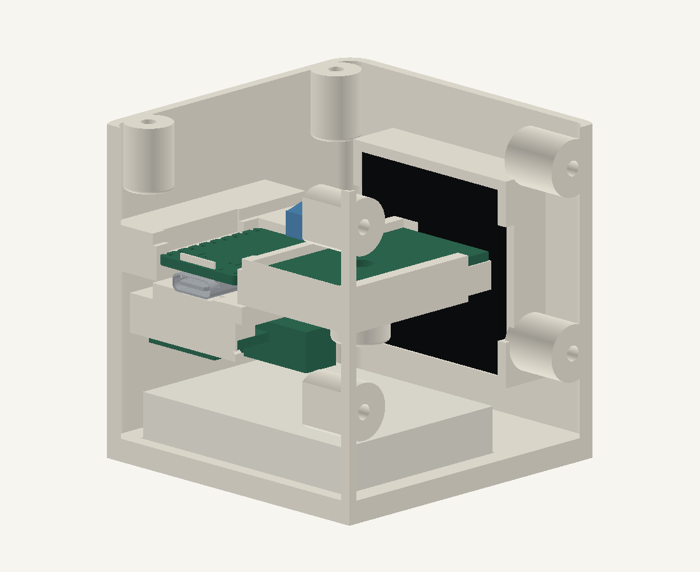

Figure 2. Internal electronic layout of the Token.

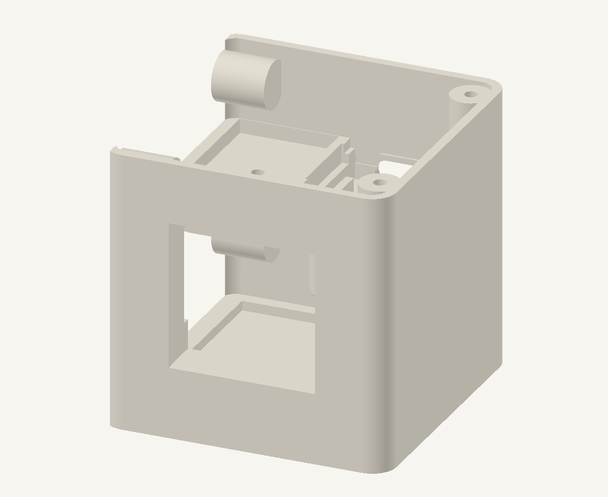

Figure 3. Front LED surround and rear mounting space.

### 6.2  Time Tower Interaction: Physical Form and Implemented Display

Time Tower holds an 8 × 32 WS2812B flexible LED panel vertically inside its front window. In the **integrated demonstration**, the left three columns accumulate completed units from the three real Study, Gaming and Exercise Tokens, while the right three columns contain an explicitly **simulated second player**. The central two columns are normally blank. Activity categories have distinct colours and 3 × 3 shapes that fall into a vertical sequence. The top recess remains a physical placement feature, but **wireless submission does not require docking a Token in the recess**. The lower and upper structural sections reserve space for the power source and control boards; the firmware implementation and electrical-power limitations are detailed in Section 11.

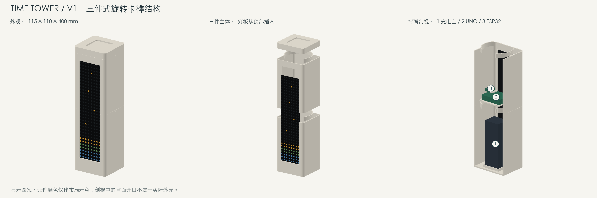

Figure 4. Proposed Time Tower exterior, internal layout, and divided structure.

### 6.3  Function Status and Verification Boundary

| Function | Intended behaviour | Current evidence | Status |
| --- | --- | --- | --- |
| Orientation sensing | Detect a deliberate flip and start timing | Three-sample filtering, threshold checks and 250 ms stable-hold logic are present; physical flip tests prompted revisions | Implemented; reliability improved, not formally quantified |
| Token LED progress and prompts | Show readiness, progress, waiting, success and return-to-normal | Full-screen 8-row timer, rotated waiting/checkmark, and alternating checkmark/return arrow in current code | Implemented; Exercise Token intermittent blackout still under investigation |
| Vibration feedback | Provide haptic feedback at completion | Original GPIO HIGH/LOW test did not reliably activate purchased module | **Not verified** |
| Token-to-Tower communication | Submit activity and receive an acknowledgement tied to the actual Drop result | ESP-NOW and two-way UART firmware implemented; physical serial log confirmed a matched `DROP_DONE` in an earlier integrated test | Implemented, with partial physical confirmation; v3 regression still required |
| Tower activity display | Accumulate units as colour/shape-coded drops | Left real records, right scripted simulation and 10-unit limit implemented; random colours observed under higher electrical load | Implemented; display power safety not resolved |
| End-of-round display | Hold, run full-panel colour animation and coordinate software reboot | Current R4 code specifies 10 s hold and 5 s green/blue/red breathing, and v3 reset messages | Implemented in code; full five-board field verification pending |
| Tower top placement | Fit the Token into the 62 × 62 mm recess | CAD interference check passed; Figure 28 shows a Token positioned on top of the assembled Tower, but does not establish the exact recess fit or retention | Visually documented; close-up fit test pending |

### 6.4  Preparation and Quotation

Before modelling began, the project produced a prototype quotation for an interactive LED system containing three Time Tokens and one Time Tower. It recorded the core parts already purchased, an optional independent power solution, and the 3D printing and assembly costs that still needed to be calculated. This shows that component choices, quantities, and budget boundaries were organised before the enclosure was designed.

| Quotation category | Amount (AUD) | Description |
| --- | --- | --- |
| Value of purchased core components | $132.20 | LED matrices, accelerometers, original XIAO controllers, Tower LED panel, and UNO R4 Minima |
| Optional independent power solution | $58.14 | Three sets of LiPo batteries, charging boards, 5 V boost modules, and power switches |
| Known project value | $190.34 | Total value of core components and all optional power components |
| Not yet priced | Pending quotation | 3D printing, wires, headers, solder, heat-shrink tubing, screws, and shipping |

The quotation is dated 9 September 2026. It still lists the Seeed Studio XIAO SAMD21 as the Token controller. The final enclosure was later changed to fit a Waveshare ESP32-S3-Zero for communication capability and compatibility with the available board. The quotation should therefore be treated as evidence of early purchasing and budgeting rather than the final bill of materials.

### 6.5  Power Scope Decision

The early quotation allowed for a LiPo battery, charging board, 5 V boost module, and separate switch in each Token. Adding these parts would significantly increase the Token's size, wiring complexity, and cost. The course prototype uses external USB power for the Tokens rather than a built-in battery in this physical design. The enclosure includes space allocated to a PB200 power bank; however, the **later actual Tower setup was reported as powering the UNO R4 through its barrel/DC jack while feeding the 256-pixel LED panel from the R4 5 V path**. This high-current arrangement remains an electrical-safety concern. Lowering the software brightness to 20 prevented the observed random-colour failure in a recent test, **but did not prove that the power arrangement is adequate or safe**. A correctly rated, protected independent 5 V supply to the LED panel, with common ground and appropriate wiring, should be verified before prolonged operation.

## 7  Component Selection and Hardware Structure

The commercial components are divided between the Token and Tower. They were selected according to size, availability, programmability, connector direction and their fit within the 3D printed structure. This section primarily records the **physical mounting decisions**; Section 11 documents the functionality subsequently implemented in code and its verification status.

### 7.1  Time Token Components

| Component | Nominal size or specification | Purpose | Mounting method |
| --- | --- | --- | --- |
| Waveshare ESP32-S3-Zero | Board length about 23 mm; USB-C on the underside | Controller, sensor reading, LED control, and implemented ESP-NOW communication | Lowered support platform with an extended retaining bar; USB-C aligned with the rear capsule-shaped opening |
| MMA8452Q accelerometer | 35 × 20 × 7 mm | Detect Token position and orientation | Supported by three cross ribs; M4 × 10 pointed screw with a Ø2.7 mm pilot hole in the plastic |
| MAX7219 8 × 8 LED module | Face about 32 × 32 mm; module and driver about 9 mm thick; transparent cover adds about 1 mm | Display progress and completion animation | Four-sided front surround; pushed outwards from inside; no screws in the confined space |
| 5 V three-pin vibration module | Nominal PCB 23 × 21 mm; rated at 60 mA with about 90 mA starting current | Haptic feedback after completion | Close-fitting rail in the main shell with clearance for the three-pin connector and solder; function not yet verified |
| Mini breadboard | 47 × 35 × 10 mm | Connect and organise prototype wiring | Locating slot about 2 mm deep in the base |


Figure 5. Final internal supports: thin sensor base with cross ribs, lowered ESP32 area, and vibration-module rail below.

### 7.2  Time Tower Components

| Component | Specification | Purpose | Structural position |
| --- | --- | --- | --- |
| WS2812B 8 × 32 RGB LED panel | 316 × 80 × 2 mm, flexible black PCB | Display the vertical time record | Inserted from the top into left and right rails; located by approximately 3 mm blank edges |
| Arduino UNO R4 Minima | Existing development board | Drive the Tower display and overall logic | Removable support platform at the rear of the upper section |
| ESP32-S3-Zero | Compact wireless controller | Receives ESP-NOW Token data, bridges two-way UART and coordinates acknowledgements and round resets | Separate support platform at the rear of the upper section |
| CUKTECH 15 PB200 | 20,000 mAh power bank | Provide portable power for the Tower | Placed vertically at the rear of the lower section with ports facing upward |

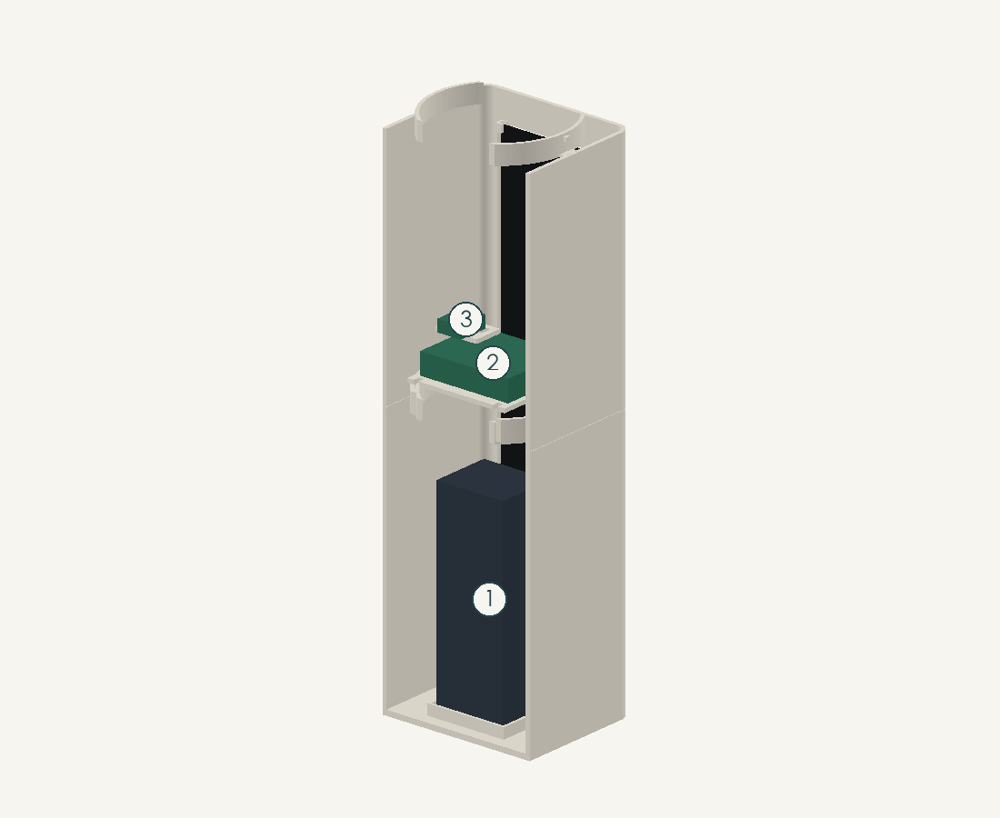

Figure 6. Internal layout of the Tower LED, power bank, and control boards.


Figure 7. Relationship between the lower section, upper section, and top cap.

## 8  Four Physical Iterations of Time Token

The project files contain CAD subversions from V1 to V11, but these do not represent eleven physical iterations. Based on the making record, the development is grouped into four rounds that involved printing, assembly, or physical fitting. Intermediate CAD versions only show how problems within the same physical round were corrected.

### 8.1  Physical Iteration One  Direct Assembly Around Purchased Components

The first round connected the LED, accelerometer, XIAO controller, and breadboard into a working electronic prototype before building a fixed enclosure around them. The first enclosure measured about 90 × 90 × 80 mm. Its purpose was to confirm component positions and cable paths rather than achieve a portable size. The physical prototype revealed that the jumper wires were long, the LED driver and connectors required more depth, and the upper and lower internal spaces needed to be reorganised.

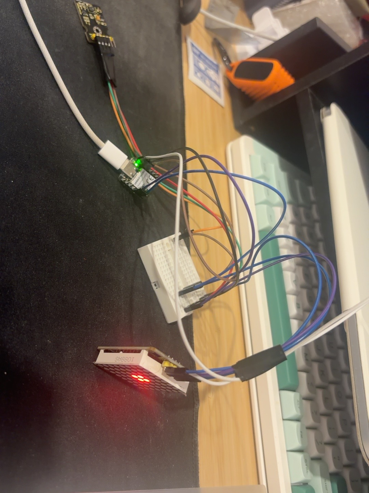

Figure 8. First physical prototype with electronic components directly connected.

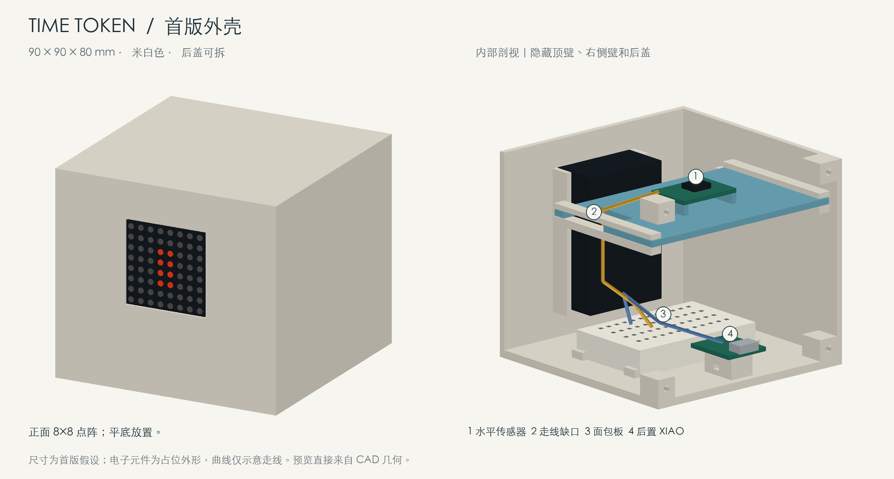

Figure 9. First enclosure and section view built around the original components.

### 8.2  Physical Iteration Two  Reducing the Enclosure to 60 mm and Adding Cable Clearance

The second round reduced the enclosure to about 60 × 60 × 60 mm and changed it to a main shell with an integrated left-and-top cover. The breadboard sat inside a recessed locating slot, while the controller and accelerometer occupied the second level. The first fitting test showed that the jumper connectors above the LED added height and prevented the cover from closing. The LED was therefore lowered, a cable opening was added, and the screw mounts were redesigned for the available M4 × 10 pointed screws.

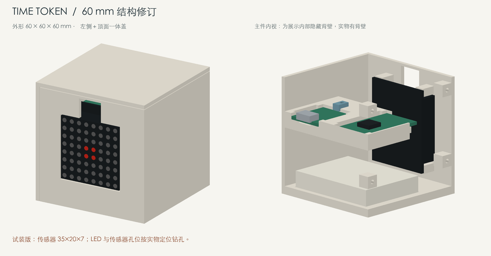

Figure 10. Second-round 60 mm layout and two-level structure.

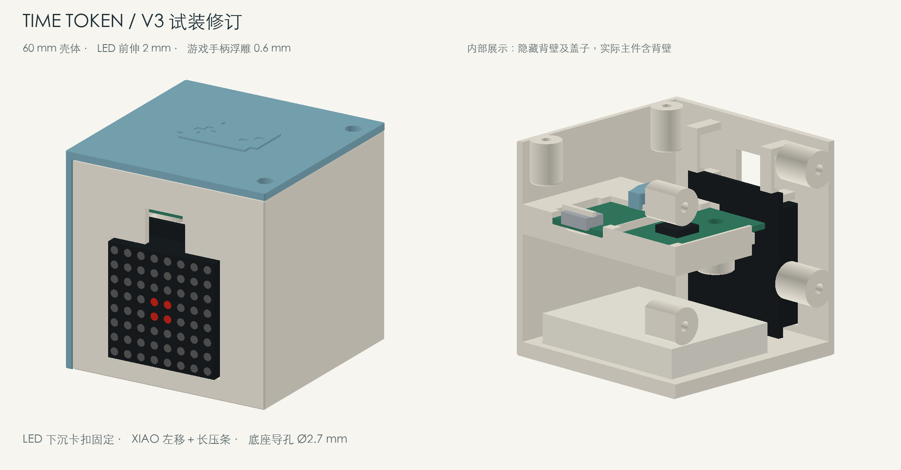

Figure 11. Revision with lowered LED, shallow base slot, and upper retainer.

### 8.3  Physical Iteration Three  Replacing the LED Kit and Redesigning Front Retention

The third round adopted a three-pack of MAX7219 8 × 8 LED modules. The new module has a driver approximately the same size as the LED face, places the input connector on the back, and provides fixed red, green, and blue versions. This removed the previous top connector from the cover space. The enclosure was changed to wrap around all four edges of the front panel, allowing the module to be secured by pushing it outwards from inside. Physical fitting showed that this was firm enough without screws or complex clips in the limited space. The controller also changed from the XIAO SAMD21 to the ESP32-S3-Zero, so the USB-C opening and retaining bar were updated.

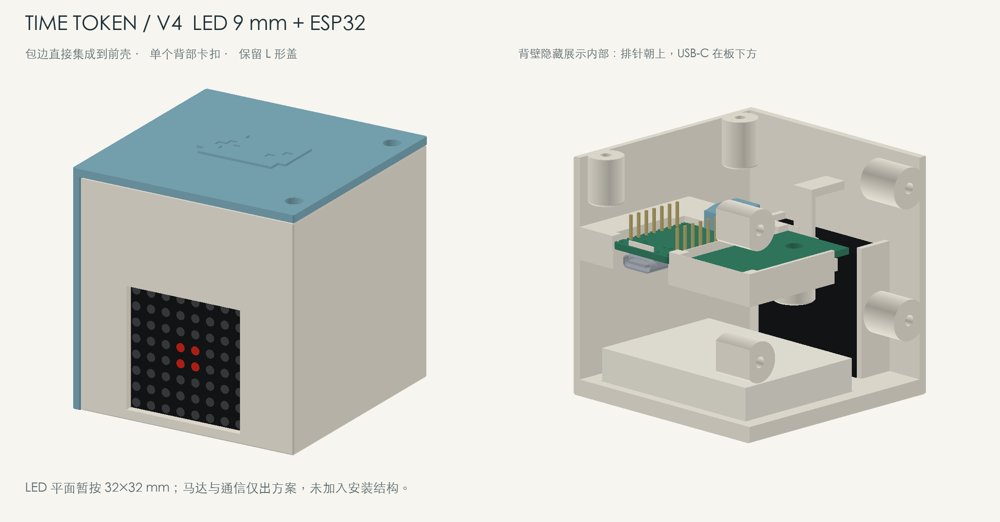

Figure 12. Structural rearrangement for the new LED module and ESP32-S3-Zero.

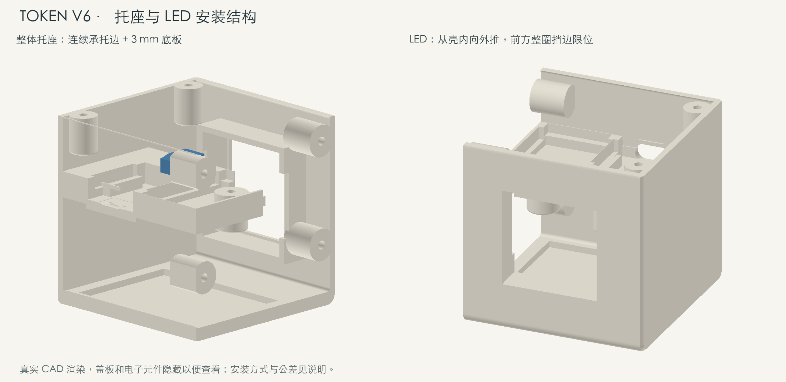

Figure 13. Tray, supports, and USB-C opening reinforced after print testing.

#### Physical evidence from iteration three

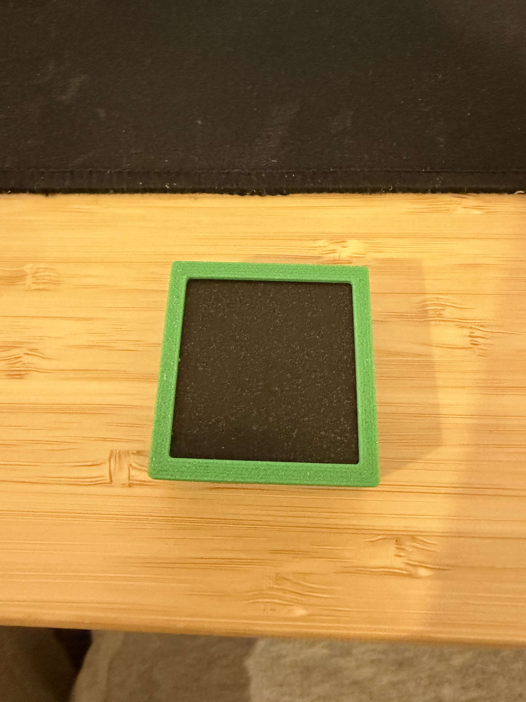

Figure 14. Front view of the black LED panel fitted into the printed frame.

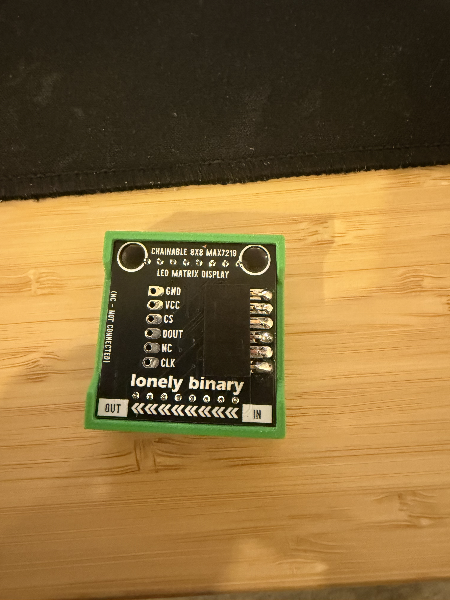

Figure 15. Rear driver and the retained PCB edges.

### 8.4  Physical Iteration Four  Final Exterior and Internal Assembly

The fourth round combined the exterior and internal mounting system into the final course prototype. The four vertical edges use an approximately R5 corner radius, while the top and bottom remain flat to prevent large curves from creating rough unsupported surfaces during printing. Three raised-symbol lids represent study, entertainment, and rest. The sensor base was made thinner and supported by three cross ribs, with the screw-hole centre positioned 22 mm from the rear inner wall. The ESP32 platform was lowered by 2 mm, and the vibration-module rail was moved below it. The bottom profile was checked for interference with the recess at the top of the Tower.

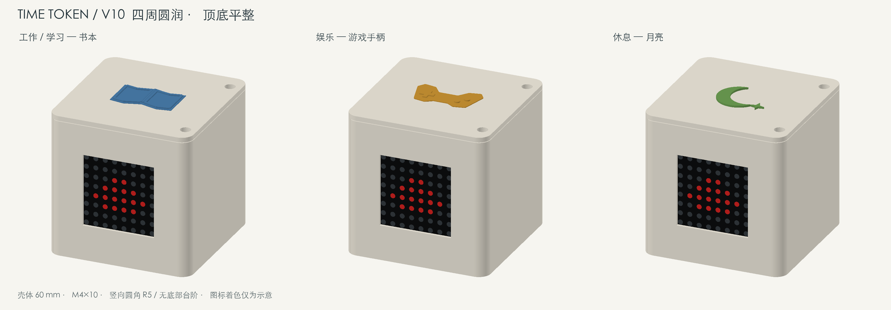

Figure 16. Final three lids with rounded vertical edges and flat top and bottom surfaces.

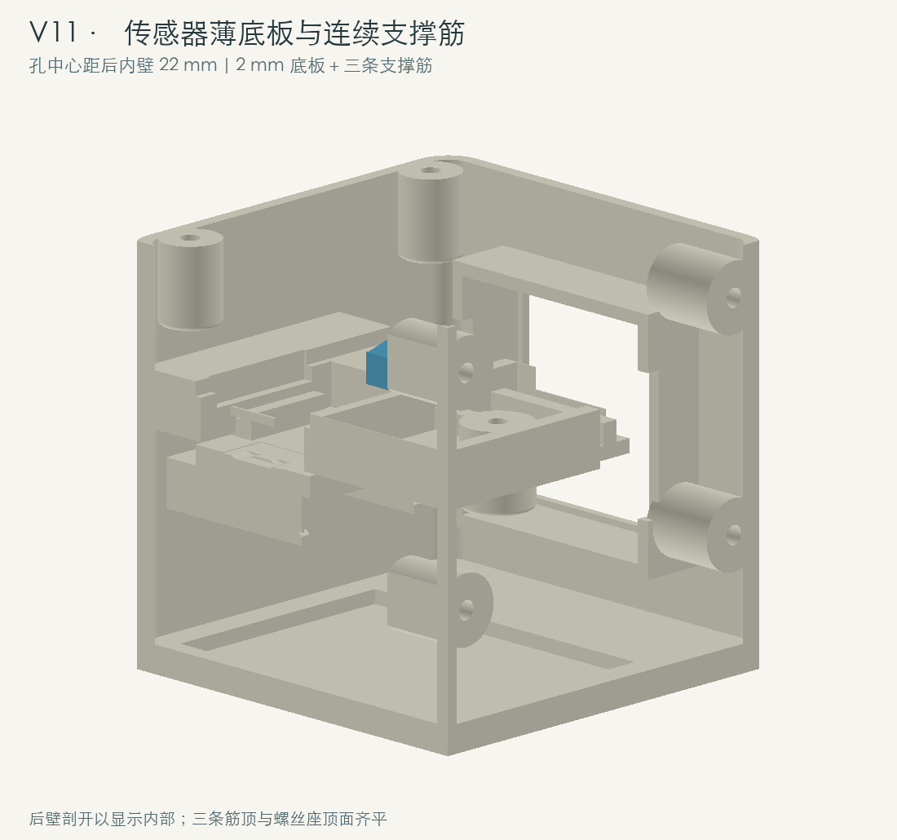

Figure 17. Final sensor support ribs and continuous internal support surface.

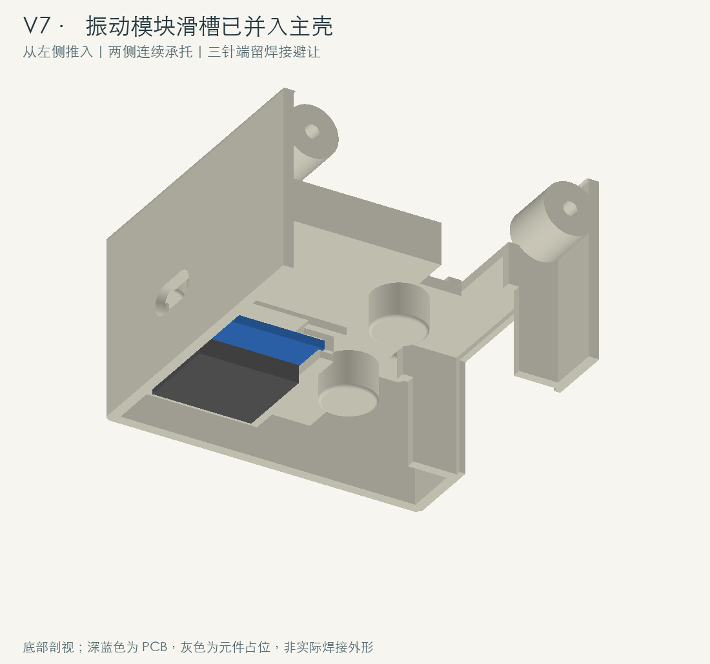

Figure 18. Screwless rail that allows the vibration module to slide directly into the main shell.

The final version includes printable STEP and STL files and an editable Shapr3D file. Geometry, mesh, and offline slicing checks have also been completed. A photograph of the assembled final exhibition prototype is now included as **Figure 28**. Close-up evidence of the internal assembly, vibration wiring and fit details remains to be added.

## 9  Time Tower Structural Development

### 9.1  Three-Part Tower Body

Time Tower measures about 115 × 110 × 400 mm. To fit the Bambu Lab A1 build volume of 256 × 256 × 256 mm, the body is printed as three parts: a lower section, upper section, and top cap. The lower section holds the PB200. The upper section holds two control boards and supports the LED panel. The top cap provides a 62 × 62 mm Token recess about 4 mm deep. Both joints use three locking tabs and approximately 15° of rotation, so each part is inserted first and then twisted into position.

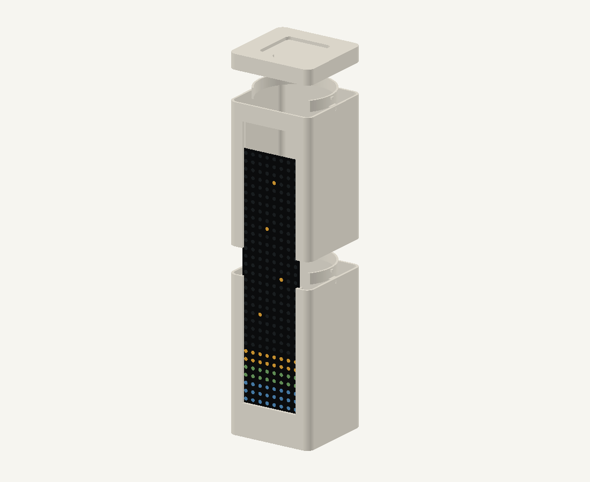

Figure 19. Three printed Time Tower parts and the continuous LED panel.

### 9.2  LED Rails and Wiring

The flexible LED panel remains flat rather than being rolled into a cylinder. The left and right rails hold only the approximately 3 mm blank edges of the panel, leaving the centre of the window open. The original plan used a backing plate behind the rails with a cable opening. The printed upper section did not include a complete rear stop, so one rail slot could not control the panel securely. A locating slot about 2 mm deep was therefore added to the lower section, together with a separate upper retainer. The retainer is inserted from the top and extends down about 50 mm. It uses the left and right inner walls, the tops of the rails, and a C-shaped clip on the right to hold the panel mechanically.

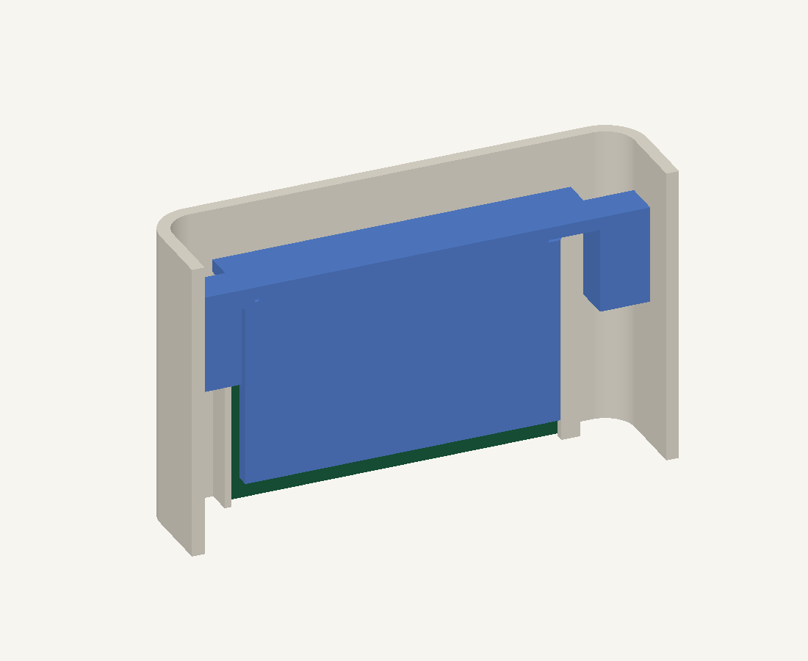

Figure 20. Upper retainer restricting the LED panel edge from the rear.

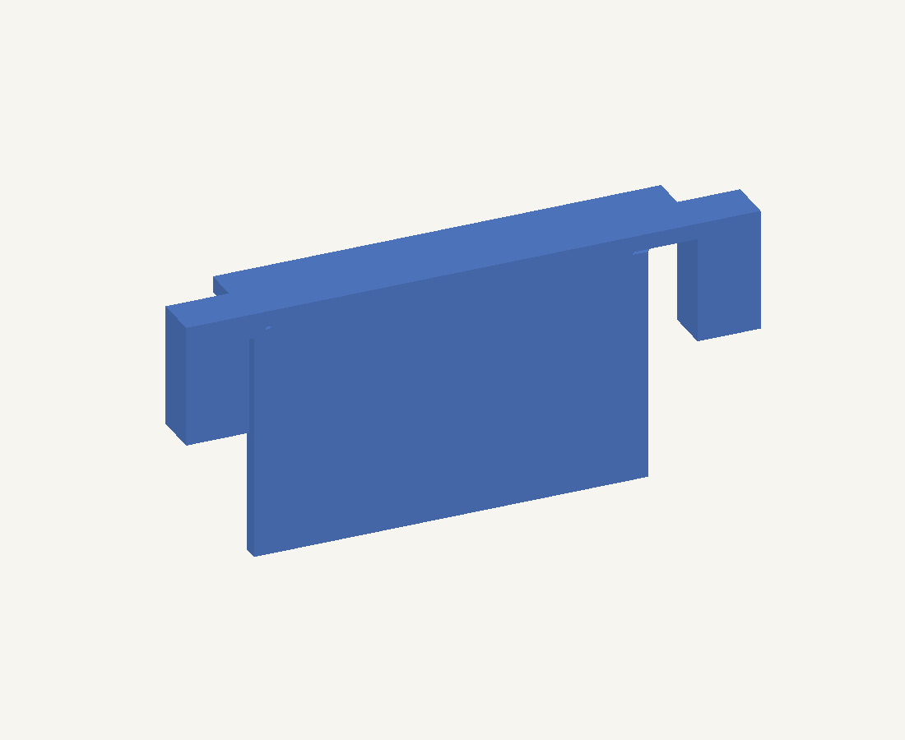

Figure 21. Locating wings, top bridge, rear stop, and right-side C-shaped clip.

### 9.3  Structural Problems Identified

- The left and right sides of the printed upper connection ring did not fully join the main body. The existing part relies mainly on its rear connection and needs reinforcement through the lower fit and additional part.

- The upper edge of the LED panel needs an additional retainer because the existing rails cannot control front-to-back movement by themselves.

- The twist-lock tabs passed CAD interference checks at selected positions, but printed tolerance, assembly feel, and long-term resistance to loosening still require physical testing.

- **Figure 28** now documents the assembled prototype and illuminated Time Tower. Close-up photos of the Token seating fit and internal mechanical connections remain to be added.

## 10  Completed Development Outputs

The project has produced more than an exterior model. It now includes prototype development records covering purchasing, electronic testing, enclosure design, print corrections, and integration with Time Tower. The following material can be used directly as evidence of individual contribution to the course project.

| Output | Details | Evidence location |
| --- | --- | --- |
| Prototype quotation | Core components, optional power, and budget boundaries for three Tokens and one shared device | LED互动装置原型报价单.xlsx |
| Time Token CAD | Main shell, three lids, ESP32 retaining bar, sensor support, and vibration-module rail | outputs/v2 to v11; STEP, STL, and Shapr3D |
| Physical fitting record | Initial electronic prototype, new LED module frame, and photographs of print issues | outputs/reference_photos and work/token_v6_photos |
| Print verification | Closed-mesh checks, geometry interference checks, A1 offline slicing, and fit checks | geometry_check, slice_review, and fit_check for each version |
| Time Tower CAD | Lower section, upper section, top cap, twist-lock test pieces, electronics layout, and LED rails | outputs/time_tower_v1 |
| Tower LED reinforcement part | 50 mm rear stop, left and right locating wings, and right-side C-shaped clip | outputs/led_top_retainer_v1 |
| Test firmware | Accelerometer diagnostics, MAX7219 tests, eight-second animation, and vibration GPIO tests (early versions) | Original `firmware` directory; see later five-board implementation in Section 11 |

### 10.1  Physical-Design Contribution (Original 18 September Record)

I was responsible for turning the selected interaction concept into a physical system that could be purchased, wired, programmed, modelled, and printed. I prepared the prototype quotation and component requirements, revised the Time Token enclosure in response to real components and print results, and completed mounting structures for the LED, accelerometer, ESP32, and vibration module. I also designed the three-part Time Tower body, LED rails, Token recess, and later reinforcement part. I did not count every CAD change as a completed iteration. The development evidence is organised around four rounds of physical making and fitting.

At the time of this **original physical-design record**, the component fit, orientation sensing and LED matrix had been tested separately. Later firmware work integrated ESP-NOW, bidirectional UART and matched Drop acknowledgements (see Section 11). **Figure 28** now provides a later photograph of the assembled exhibition prototype; however, vibration performance, hidden internal assembly details and final mechanical fit still require separate evidence.

### 10.2  Final Physical Photographs

The completed exhibition arrangement is documented in **Figure 28**, which is a photograph of the actual prototype rather than a CAD render. The photograph shows the assembled Time Tower with illuminated activity patterns, two freestanding Time Tokens, and a third Token positioned at the top of the Tower. This documents the visible physical arrangement and LED presentation; it does not, by itself, verify wireless reliability, internal wiring, exact mounting tolerances or long-term electrical stability.

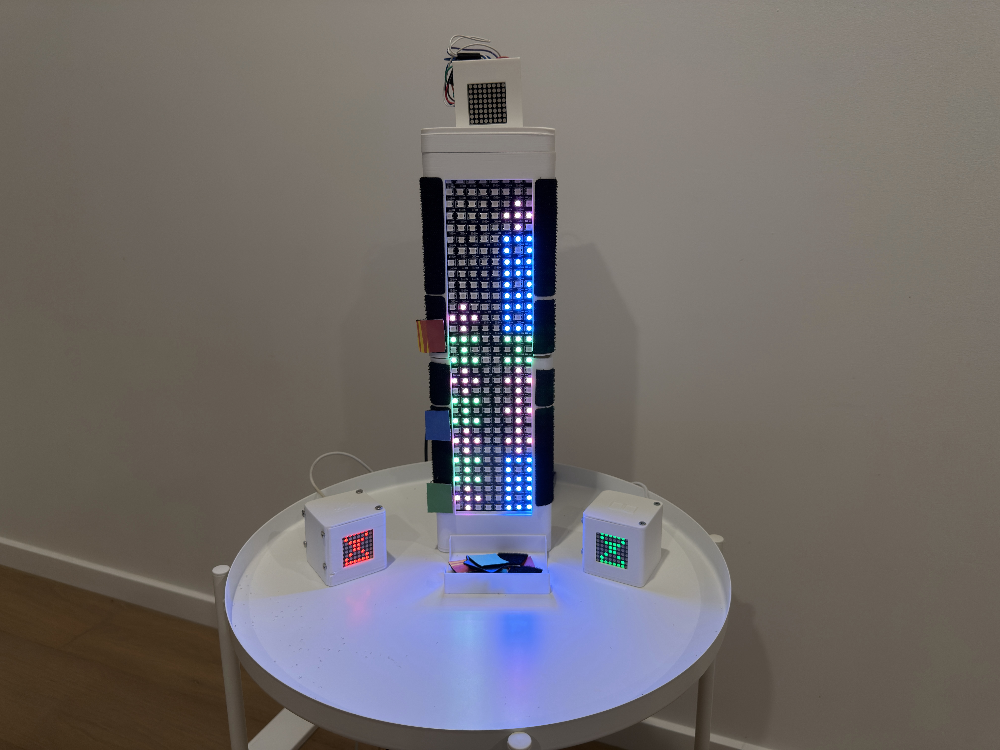

*Figure 28. Final physical prototype of Time Tokens and Time Tower, showing the illuminated shared LED display and three Time Tokens in the exhibition arrangement.*

### 10.3  Main References and Purchase Records

| Item | Record |
| --- | --- |
| MAX7219 LED three-pack | Amazon Australia  B0GYRTNQZ3 |
| MMA8452Q accelerometer | Keyestudio KS0270 product and tutorial page |
| Vibration module | Amazon Australia  B0H7WZ1L44; 3.0–5.3 V, rated at 60 mA |
| WS2812B 8 × 32 panel | User-provided specification: 316 × 80 × 2 mm |
| Power bank | CUKTECH 15  PB200  20,000 mAh |
| 3D printer | Bambu Lab A1  256 × 256 × 256 mm build volume |

## 11  Firmware Development, Integration and Iteration

> **Scope and contribution:** This section records the firmware development process as a separate contribution from the enclosure and CAD work in Sections 6–10. It follows the actual sequence of small implementations, debug sessions, user-feedback-driven revisions and integration decisions. An implementation in a `.ino` file is not automatically a verified result: successful serial tests, source-code features and remaining hardware limitations are distinguished below.

### 11.1  Starting with a modular five-board architecture

The main firmware challenge was linking two types of interaction: the **local Token interaction** (flip, time, display and return) and the **shared Tower record** (receive, animate, store and acknowledge). Instead of building the whole network at once, I separated the responsibilities and tested each layer before adding the next one.

| Board | Firmware responsibility | Current source sketch |
| --- | --- | --- |
| Exercise Token — ESP32-S3-Zero, ID 1 | MMA8452Q orientation, MAX7219 UI, time-unit creation, ESP-NOW transmission and result feedback | `firmware/Token_Exercise_Final180/Token_Exercise_Final180.ino` |
| Study Token — ESP32-S3-Zero, ID 2 | Same interaction states, with the activity encoded as `STUDY = 1` | `firmware/Token_Study_Final180/Token_Study_Final180.ino` |
| Gaming Token — ESP32-S3-Zero, ID 3 | Same interaction states, with the activity encoded as `GAMING = 3` | `firmware/Token_Gaming_Final180/Token_Gaming_Final180.ino` |
| Tower communication bridge — ESP32-S3-Zero | Receive ESP-NOW messages, match requests, send/receive UART, relay outcomes, coordinate rounds | `firmware/Tower_Bridge_DemoCycle_v3/Tower_Bridge_DemoCycle_v3.ino` |
| Tower LED controller — UNO R4 Minima | Draw 8 × 32 pixels, run two-column Drops, simulate another player, manage full/closing/reboot stages | `firmware/R4_Tower_Breath5s_B20/R4_Tower_Breath5s_B20.ino` |

The hardware split is intentional: the Tower ESP32 manages wireless communication, while the R4 performs deterministic drawing for the WS2812B matrix. The R4's normal LED scenes are independent of Wi-Fi transport; the ESP32 translates between the two sides. **The current DemoCycle v3 sketches must be used as a matching set**, because earlier versions used incompatible packet formats.

### 11.2  Firmware milestone 1 — Proving the individual components

**Question.** Could the Token reliably sense which face was down and display meaningful information in a compact 8 × 8 matrix?

**Work performed.** I started with minimal test sketches for orientation readings and LED output before joining them. The initial firmware used an Arduino-compatible controller and was later moved to the **Waveshare ESP32-S3-Zero**, enabling built-in ESP-NOW without a separate radio module. The **MMA8452Q** is read over I²C (`SDA=GPIO1`, `SCL=GPIO2`); the MAX7219 is controlled through `DIN=GPIO4`, `CS=GPIO5`, `CLK=GPIO6`. The display driver writes MAX7219 registers directly, allowing small symbols and animated frames without introducing a new display abstraction.

**Problem → response.** A binary tilt indication could react to small movement and could not reliably distinguish an intentional flip. The accelerometer provided a measurable Z value, which could then be filtered and checked over time. Separately, all-on LED patterns placed more load on the Token display than the earlier small icons; brightness was kept at the MAX7219's lowest intensity (`BRIGHTNESS = 0`) while hardware stability was investigated.

**Evidence.** Separate serial sensor readings, LED tests and progressive physical debugging; these establish the component functions, not long-term reliability.

### 11.3  Firmware milestone 2 — Building a reliable flip-to-start state machine

**Question.** How do we start a new time unit on purpose, without accidental activation from brief movements?

The original flip logic was gradually revised into a clear state-driven interaction. Relevant functions include `readOrientationSample()`, `isNormal()`, `isFlipped()`, `beginFlipAttempt()`, `startSession()` and the main `loop()` state handling. The important design choices were:

- **Input:** fresh acceleration samples, especially the sensor's Z-axis value.
- **Filtering:** a rolling average over **three newly received samples**, with a short-gap check so stale data cannot count as a stable hold.
- **Conditions:** `NORMAL_THRESHOLD = +0.60`, `FLIPPED_THRESHOLD = -0.30`, and `CONFIRM_MS = 250` ms.
- **Action:** when the stable flipped orientation is confirmed, `startSession()` starts the eight-second session and resets the relevant animation state.
- **Visible feedback:** a clockwise arrow continues to guide the user if a flip attempt fails or needs to be retried; movement does not silently cancel all opportunities to start.

This change addressed observations that participants did not always know **when to flip** and sometimes could not tell whether the flip had registered. It improved the interaction's explicit feedback, but a controlled measurement of first-attempt flip success was not included in the supplied evidence.

### 11.4  Firmware milestone 3 — Making time visible on the Token

The display sequence developed from a few sparse LED signals into a clearer vocabulary:

| Interface state | Display | Intended meaning |
| --- | --- | --- |
| Ready / preparing | Hourglass and/or orientation guide | A new time unit can be started through the correct flip |
| Start confirmation | Clockwise arrow response | The user is deliberately entering the active orientation |
| Running | 8-second full-panel row-fill animation | One conceptual hour is being represented in eight visible steps |
| Local completion | Short completion blink / pattern | The interval has ended; sending is a **separate** process |
| Waiting for processing result | Three animated dots, displayed for inverted viewing | Sending or processing is still pending; success is **not** yet known |
| Verified R4 processing report | Alternating ✓ and clockwise return arrow, both rotated 180° | The shared R4 has reported completion; return the Token upright |
| Explicit rejection or timeout | `X` for rejection; `!` for unknown result | Do not claim that a time unit has been accepted |

I first tested the 8 × 8 progress display as a growing line. Later, to make the passage of time easier to read, `showProgress(stage)` was changed to light **one complete row (eight LEDs) per stage**, reaching **all 64 LEDs** in the eighth stage. Since the Token is physically upside down during timing, the row order was then reversed so the person sees the display build **from the bottom upward** in the flipped orientation.

The final row-fill implementation is deliberately local to this function; the arrow, hourglass and other results are not globally rotated:

```cpp
void showProgress(uint8_t stage) {
  if (stage > 8) stage = 8;
  clearMatrix();
  for (uint8_t i = 0; i < stage; ++i) {
    maxWrite(1 + i, 0xFF); // Row order for the physically inverted Token
  }
}
```

The final success cue is also **not just a timed animation**. It is driven by the final ACK state and alternates every `RETURN_SWAP_MS = 800` ms. The display remains visible for at least `RESULT_CUE_MS = 2000` ms before the user can complete the return-to-ready transition.

### 11.5  Firmware milestone 4 — Building the Tower's shared activity display

The Tower LED controller was tested independently before wireless integration. It drives a **256-pixel WS2812B matrix (8 columns × 32 rows)** from UNO R4 `D6`. The display address mapping uses a serpentine pattern: pixel zero is at the bottom-left; even rows move left-to-right and odd rows right-to-left. Each activity is encoded using a **3 × 3 coloured shape**:

```text
STUDY — blue        EXERCISE — green    GAMING — pink/red
XXX                 XXX                 .X.
X.X                 .X.                 XXX
XXX                 XXX                 .X.
```

The first working Tower implementation read a simple serial record and used `dropTimeUnit()` to animate a block falling from the top of a lane to the next available position. Each 3 × 3 unit occupies three rows; **10 units** fit in each lane. `person0Units`/`person1Units` and their counters represent the current demonstration scene in RAM. A final scene redraw preserves units already landed while a new one is moving.

As the design changed from one person on each side to three activity Tokens belonging to one real user, the mapping became **Token IDs 1, 2 and 3 → the left lane**. The right lane was reassigned to an explicitly simulated participant rather than being treated as real second-user data.

### 11.6  Firmware milestone 5 — First wireless submission (ESP-NOW → UART)

The first networked version sent a compact `TokenPacket` from the Token's ESP32 using **ESP-NOW channel 6**. Its fields included `tokenID`, `activity`, `totalUnits`, `newUnits` and `messageNumber`. The Tower ESP32 received the radio packet and forwarded a CSV command over **UART at 9600 baud** to the R4, which executed the Drop animation.

```text
PERSONAL TOKEN ESP32
       │  ESP-NOW, channel 6
       ▼
TOWER ESP32-S3-ZERO
       │  GPIO7 TX → level converter → R4 D0/RX
       ▼
UNO R4 MINIMA → WS2812B 8 × 32 display
```

This proved the basic communication route, but it exposed a design problem: a message that has been **sent successfully** is not necessarily **received by the Tower**, and a message received by the Tower is not necessarily **drawn by the R4**. We therefore did not treat successful wireless transmission as a sufficient confirmation to the user.

### 11.7  Firmware milestone 6 — Receiver ACK, reverse UART, and genuine `DROP_DONE`

We implemented confirmation **incrementally rather than all at once**, so each layer could be checked separately.

| Iteration | Technical change | What it actually established |
| --- | --- | --- |
| A. Receiver-only ACK | The Tower ESP32 returned a matched receipt message to the Token. | The wireless bridge had received the packet; the R4 result was still unknown. |
| B. Reverse UART wire test | Added **R4 D1/TX → level converter → Tower ESP32 GPIO8**. R4 sent `R4_LINK_TEST` sequences. | The return data wire worked, but those messages were **not** Drop completion acknowledgements. |
| C. Correlated Drop acknowledgement | Added message numbers to R4 commands; the R4 returned `DROP_DONE` only after storing the new unit in RAM and issuing the final LED update, or `DROP_FAIL` for a definite rejection. | The Tower ESP32 could distinguish a completed Drop from a mere received packet. |
| D. End-to-end result | The Tower ESP32 relayed the matched R4 outcome to the personal Token. | The Token could show ✓ only for its **own** completed request. |

A physical serial-monitor test showed the sequence:

```text
UART request -> R4: 1,2,1,1
[R4 -> ESP32] DROP_DONE,1,2,1,1
=== R4 DROP CONFIRMED ===
```

That log is evidence of a **specific successful request and corresponding R4 reply** in the earlier protocol. It is not evidence that every possible future case, every LED, or the latest five-board release has passed a complete system test. The final v3 request format is different and must not be mixed with this historical example.

### 11.8  Firmware milestone 7 — Validating the final result and guiding a second cycle

When early users were unsure whether data had reached the shared device, the Token UI was expanded to distinguish the states **waiting**, **success**, **rejection**, and **unknown**. The current logic can be found in `pollTransferAck()`, `updateTransferDisplay()` and `completionCanReturnToReady()`:

- `pollTransferAck()` receives queued ACK events, verifies the current request's device, activity, round, boot and message identifiers, and updates the result state only for a matching response. A receiver-only ACK cannot produce ✓.
- `updateTransferDisplay(now)` selects the appropriate LED pattern. Waiting is three dots; a completed request alternates the inverted ✓ and clockwise arrow; rejection or unknown results show the corresponding cue.
- `completionCanReturnToReady(now)` keeps result feedback visible for a minimum period. The next session is started only through the active user gesture of returning the Token to its normal face and then flipping again.

The design retained the team's decision to have an **active interaction at the end of each conceptual hour**. Some evaluation comments suggested that repeated flipping could interrupt concentration; retaining it was an intentional trade-off, **not evidence that the interruption improves reflection or productivity**.

### 11.9  Firmware milestone 8 — Adding a simulated second player

For an exhibition demonstration, the real left lane requires someone to interact with the physical Tokens. To make the Tower's social-comparison idea visible even when one person is testing alone, the R4 now draws a **scripted right-side sequence**, independent of real Token messages:

```text
STUDY → STUDY → GAMING → GAMING → GAMING
      → EXERCISE → STUDY → STUDY → STUDY → GAMING
```

The first simulated Drop is scheduled after **10 seconds**, with the next beginning at subsequent 10-second intervals. The right side uses its own activity array and count; it does **not** generate an ESP-NOW Token record or a false Final ACK. The R4's newer animation logic steps individual falling blocks on a timed basis so a left-side real Drop and the simulated right-side Drop can progress without one long blocking animation dominating the program.

This feature makes the social scenario legible, but it is **a role-play prompt**, not evidence of actual simultaneous multi-user behaviour or a second participant's tracked activity.

### 11.10  Firmware milestone 9 — Completing a demonstration round and restarting

To repeat short demonstrations without manually clearing the display, a new **DemoCycle v3** control protocol was introduced. The left lane counts genuine time units from all three real Tokens. When the **10th left-side unit** lands, the Tower:

1. Returns that unit's matched `DROP_DONE` before starting the closing stage.
2. Preserves the complete scene for **10 seconds**.
3. Replaces the entire panel with a **five-second** uniform-colour breathing sequence: **green → blue → red → black**.
4. Coordinates software resets with the Tower bridge and online Tokens, then begins a fresh demonstration round.

The original close-out tried to dim the existing pixel scene uniformly. After a reported display fault, the simpler current animation was chosen: `closingColorAt(elapsed)` computes a **single RGB colour** for every pixel from elapsed time, and `drawScene()` fills all 256 pixels with it. Each colour brightens and dims smoothly, with decreasing peaks. This avoids repeatedly scaling previously modified pixel values and keeps the full-panel pattern independent of the older activity shapes.

**Protocol change:** the current wireless `DemoPacket` is **32 bytes** and carries `roundID`, `bootID`, `messageNumber` and a status field. The Tower ESP32 coordinates new rounds with `Preferences`-stored round metadata; R4 and Tokens maintain active session units in RAM. The `handleRoundState()` / `serviceRound()` Token functions and `handleR4()` / `updateControl()` bridge functions manage round messages and software resets. Devices that are offline cannot be guaranteed to reboot in synchrony.

**Important consequence:** This is a deliberately resetting **classroom demo**, not continuous day-long logging. A software reboot clears the in-RAM counters and unfinished sessions, and the right-side simulated sequence starts again from its first entry.

### 11.11  Firmware milestone 10 — Hardware debugging during integration

As the animations grew, hardware and electrical reliability became part of the firmware iteration record:

| Observed behaviour | Test or change | What can reasonably be concluded |
| --- | --- | --- |
| Tower 8 × 32 matrix showed full-panel random colours after several Drops at `BRIGHTNESS = 70`. | Reduced the R4's `BRIGHTNESS` to **20**. A follow-up observation reported no recurrence in that test. | The fault correlates with electrical load / display conditions, but safe power delivery and the exact cause have **not** been proved. |
| Exercise Token sometimes went dark near the last rows of the 64-LED progress fill, while later transfer feedback still appeared. | Tested the Exercise Token alone with a **5 V USB-C power bank**; the reported standalone test completed without the blackout. | The effect is context dependent. Power, connections, module differences and multi-device conditions still need checking. |
| Game Token's full-panel progress was reported working. | Compared its behaviour against the Exercise Token using the same row-fill logic. | Supports looking beyond a universal progress-code failure; it does **not** conclusively diagnose the Exercise module. |
| Early prompts did not make successful transfer clear. | Added genuine R4-derived final result checks and the ✓ / return-arrow sequence. | State feedback is better aligned with the processing event; natural-use understanding still needs renewed evaluation. |

**Electrical caution:** The field setup was reported to power the Tower LED panel through the R4 5 V path while the R4 itself used its DC/barrel input. A successful short demonstration at brightness 20 must **not** be treated as proof that this is a safe power arrangement for 256 addressable LEDs. The physical supply should be checked and appropriately rated before prolonged public exhibition. MAX7219 displays operate differently from the WS2812B Tower and must be debugged separately.

### 11.12  Current firmware architecture, settings and implementation evidence

```text
  [Exercise Token #1]     [Study Token #2]     [Gaming Token #3]
         |                       |                    |
         +-----------------------+--------------------+
                                 | ESP-NOW channel 6
                                 v
                       [Tower ESP32 bridge]
                           |           ^
                  GPIO7 TX |           | GPIO8 RX
                           v           |
                        [UNO R4 Minima]
                                 |
                         D6 → WS2812B 8×32
                          LEFT: real units
                          RIGHT: simulation

  R4 Drop completed → UART result → Tower ESP32 → matched Final ACK
                                   → Token ✓ ↔ return arrow
```

| Area | Current parameter | Meaning |
| --- | --- | --- |
| All Tokens | `DURATION = 8000` | 8-second demonstration for one conceptual hour |
| All Tokens | `CONFIRM_MS = 250` | Stable-orientation confirmation |
| All Tokens | `BRIGHTNESS = 0` | Lowest MAX7219 intensity setting |
| All Tokens | `RETURN_SWAP_MS = 800` | Inverted ✓ and clockwise arrow alternate after final ACK |
| All Tokens | `FINAL_ACK_TIMEOUT_MS = 35000` | Unknown outcome if no matching result is received in time |
| Tower ESP32 | `ESPNOW_CHANNEL = 6`; UART RX/TX = GPIO8/GPIO7 | Wireless connection and two-way serial relay |
| UNO R4 | `LED_PIN = 6`; `BRIGHTNESS = 20` | 8 × 32 panel output; brightness used in the latest reported successful short test |
| UNO R4 | `DROP_DELAY = 70` | Approximate interval per falling-animation step |
| UNO R4 | `MAX_UNITS = 10` | Maximum units per lane |
| UNO R4 | `SIM_INTERVAL_MS = 10000` | Right-side simulated Drop schedule |
| UNO R4 | `FULL_HOLD_MS = 10000`; `FADE_MS = 5000` | Final scene hold and entire green/blue/red closing animation |

**Evidence and verification status.** The project record includes component tests, multiple Arduino revisions, screenshots of a matched UART `DROP_DONE`, and reported user sessions. The final five-board package preserves a latest-source baseline and has been checked for its main IDs, settings and file structure. **A full Arduino hardware-target build, long multi-board endurance trial, simultaneous right/left animation stress test and verified supply-voltage measurement have not been documented for the exact final merged release.** Test outcomes must not be promoted into stronger claims than this record supports.

**Older-version caution.** The historical receiver-only ACK, return-link and plain `DROP_DONE` examples used different packet formats (including 10-byte data / 16-byte receiver ACK). Those files are valuable **development evidence** but cannot be uploaded in place of the current DemoCycle v3 versions.

### 11.13  Firmware contribution and reflection

My main firmware contribution was developing and integrating the **Token-side interaction logic, Tower display behaviour and the link between them**, then revising that implementation in response to usability testing and physical debugging. Rather than building every feature in one large step, I tested orientation sensing, LED output and serial communication separately, then layered wireless transfer, genuine acknowledgements, multi-Token identity, simulated social display and demonstration-round control.

The most important design lesson was that a **working timer is not the same as an understandable interaction**, and a successful wireless send is **not the same as a completed shared record**. The feedback now distinguishes what the Token knows locally, what the Tower bridge received, and what the R4 actually reported after updating its scene. I also learned that visual improvements increase hardware demands: adding a full 64-LED progress fill and a full-panel closing animation made power and signal stability important design constraints, not just implementation details.

This contribution should be described alongside, not as a replacement for, the enclosure-design and physical-making work in Section 10.1. It records implementation and iteration; it does not claim that the prototype has proved long-term behaviour change or resolved every electrical issue.

### 11.14  Code package, upload order and further evidence

The accompanying code package contains **five complete Arduino sketches** (listed in Section 11.1). Each folder has a `.ino` with the **same name** as its folder, which allows Arduino IDE to open it independently. Upload order: **R4 → Tower ESP32 → Exercise Token → Study Token → Gaming Token**. After confirming that demonstration RAM data can be discarded, restart the R4, the bridge and then the Tokens for a clean shared round.

For the full wiring, library and pin list, see the separate English firmware guide supplied with the five-board release. The existing project links remain the preferred locations for task protocols, evaluation evidence and deployment instructions. The project would benefit from additional **close-up assembly photographs beyond Figure 28**, a final in-situ video of all boards, timed serial logs for a complete 10-unit close-out cycle and a measurement of LED power stability.

## Deployment and Testing

- [Deployment guide](deployment-guide.md)
- [Evaluation evidence](../research/user_test/README.md)
- Firmware development and code evidence: Section 11 above; use the matching five-board DemoCycle v3 source package.
